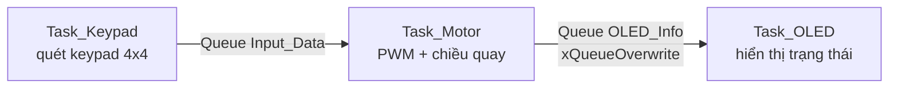

# STM32_REG: Lập trình thanh ghi STM32F103 với FreeRTOS

Tập hợp các bài thực hành **lập trình trực tiếp trên thanh ghi** (register-level, không dùng thư viện HAL/LL) cho vi điều khiển **STM32F103C8T6 (Blue Pill)**, kết hợp **FreeRTOS** để chia hệ thống thành các task độc lập.

Toàn bộ driver (RCC, GPIO, Timer, I2C, OLED...) đều tự viết bằng cách đọc/ghi thanh ghi theo tài liệu Reference Manual RM0008.

## Các dự án

| Dự án | Nội dung | Ngoại vi chính |
|---|---|---|
| [`ADC_DMA`](ADC_DMA) | Đọc cảm biến đa kênh liên tục, hiển thị trên OLED | ADC (Scan Continuous), DMA, I2C |
| [`DC`](DC) | Điều khiển tốc độ và chiều quay động cơ DC bằng keypad | Timer PWM, GPIO, I2C |

---

## 1. ADC_DMA: Hệ thống đọc cảm biến đa kênh

Đọc đồng thời nhiều cảm biến analog (cảm biến ánh sáng, cảm biến mưa) mà **không tốn thời gian CPU** nhờ DMA, rồi hiển thị giá trị theo thời gian thực trên màn hình OLED.

### Cách hoạt động

- **ADC1** cấu hình ở chế độ **Scan + Continuous Conversion**: bộ ADC tự quét lần lượt các kênh và lặp lại liên tục.
- **DMA1 (Channel 1)** tự chuyển kết quả chuyển đổi của từng kênh vào một mảng trong RAM, CPU không phải đọc thanh ghi dữ liệu ADC.
- **FreeRTOS** chia thành 2 task:
  - **Task thu thập:** đọc mảng dữ liệu do DMA cập nhật và gửi đi.
  - **Task hiển thị:** nhận dữ liệu và vẽ lên OLED qua I2C.
- Hai task truyền dữ liệu cho nhau bằng **Queue/MailQueue**, nên không dùng biến toàn cục chung.

### Phần cứng

| Thiết bị | Ghi chú |
|---|---|
| STM32F103C8T6 (Blue Pill) | Xung nhịp hệ thống 64 MHz |
| Cảm biến ánh sáng (analog) | Chân ADC: _điền chân_ |
| Cảm biến mưa (analog) | Chân ADC: _điền chân_ |
| OLED (I2C) | SCL: PB6, SDA: PB7 |

---

## 2. DC: Điều khiển động cơ DC đa nhiệm

Điều khiển động cơ DC qua cầu H: nhập giá trị từ **keypad 4x4**, phát xung **PWM bằng Timer** để chỉnh tốc độ, đảo chiều quay và dừng. Trạng thái được hiển thị trên OLED.

### Sơ đồ task



- **Task_Keypad:** quét bàn phím, gửi phím vào Queue.
- **Task_Motor:** nhận phím, xử lý lệnh, cập nhật PWM và chân chiều quay, gửi trạng thái cho OLED.
- **Task_OLED:** chờ dữ liệu mới và hiển thị (nằm chờ nên không tốn CPU).

Việc chia task giúp nhận phím, điều khiển động cơ và hiển thị không chặn lẫn nhau.

### Điều khiển bằng keypad

| Phím | Chức năng |
|---|---|
| `0` đến `9` | Nhập giá trị (độ rộng xung, 0 đến 1000) |
| `#` | Chạy với giá trị vừa nhập |
| `*` | Xóa số đang nhập |
| `A` | Quay thuận |
| `B` | Quay ngược |
| `C` | Dừng |

### Phần cứng và chân kết nối

| Thiết bị | Chân STM32 | Ghi chú |
|---|---|---|
| PWM (TIM2_CH1) | PA0 | Vào chân ENA của cầu H, tần số 1 kHz |
| Chiều quay | PA1, PA2 | Nối IN1, IN2 của cầu H |
| OLED I2C1 | PB6 (SCL), PB7 (SDA) | |
| Keypad, hàng | PB0, PB1, PB10, PB11 | Output push-pull |
| Keypad, cột | PB12, PB13, PB14, PB15 | Input pull-up |
| Bộ đếm thời gian | TIM3 | Tạo nền thời gian 1 ms cho hàm delay |

PWM được tạo từ **TIM2**: prescaler chia xuống 1 MHz, `ARR = 1000`, nên tần số 1 kHz và độ rộng xung bằng `CCR / 1000`.

---

## Cấu trúc thư mục

```
STM32_REG/
├── ADC_DMA/
│   ├── Src/        # main.c và driver (RCC, GPIO, TIM, I2C, OLED, ADC, DMA...)
│   ├── Inc/        # Header tương ứng, FreeRTOSConfig.h
│   ├── FreeRTOS/   # Mã nguồn FreeRTOS kernel
│   └── Startup/    # File khởi động
├── DC/
│   ├── Src/        # main.c, Key_pad.c và driver
│   ├── Inc/
│   ├── FreeRTOS/
│   └── Startup/
└── README.md
```

## Biên dịch và nạp

**Công cụ:** STM32CubeIDE, ST-Link (nạp qua SWD).

1. Mở STM32CubeIDE, chọn **File → Import → General → Existing Projects into Workspace**.
2. Chọn thư mục `ADC_DMA` hoặc `DC` rồi **Finish**.
3. Build bằng `Ctrl + B`.
4. Nối ST-Link vào board và chọn **Run** (hoặc **Debug**) để nạp.

Lưu ý: file `FreeRTOSConfig.h` cần bật `INCLUDE_vTaskDelayUntil` nếu dùng hàm này, và `configTOTAL_HEAP_SIZE` đủ lớn cho số task đang dùng (RAM của chip chỉ có 20 KB).

## Kỹ thuật chính

- **Lập trình thanh ghi:** cấu hình trực tiếp RCC (bật clock), GPIO (CRL/CRH), Timer (PSC, ARR, CCR, CCMR, CCER), ADC (SQR, CR2), DMA (CPAR, CMAR, CNDTR, CCR), I2C.
- **ADC + DMA:** chuyển đổi liên tục nhiều kênh, dữ liệu vào RAM mà CPU không tham gia.
- **PWM bằng Timer:** chỉnh duty bằng cách ghi thanh ghi `CCR`.
- **FreeRTOS:** chia task, truyền dữ liệu bằng Queue, `xQueueOverwrite` cho dữ liệu hiển thị luôn lấy giá trị mới nhất.
- **Quét keypad ma trận 4x4:** kéo từng hàng xuống mức thấp rồi đọc 4 cột, có chống rung phím.

## Hướng phát triển

- **Điều khiển vòng kín PID cho tốc độ động cơ DC:** thêm encoder, đo tốc độ bằng Timer ở chế độ Encoder rồi chỉnh PWM bằng bộ điều khiển PID (cần động cơ có encoder).
- Thêm giao tiếp UART để ghi log và vẽ đồ thị đáp ứng.

## Tác giả

**Nguyễn Thành Chung**, sinh viên Kỹ thuật điện tử viễn thông, chuyên ngành Hệ thống nhúng và IoT, Học viện Công nghệ Bưu chính Viễn thông (PTIT).
